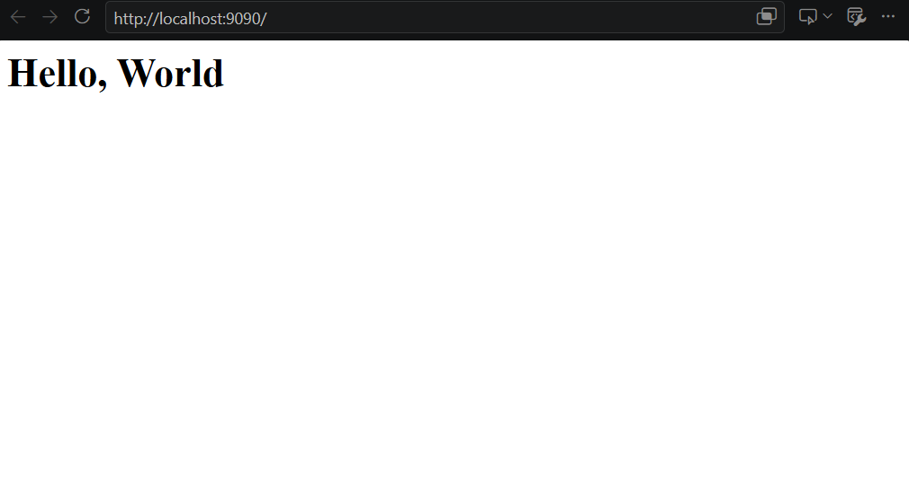

# Практическое задание 3. Раздача HTML-страницы по HTTP

## Задание

Реализовать серверную часть приложения. Клиент подключается к серверу и в ответ получает HTTP-сообщение, содержащее HTML-страницу, которую сервер подгружает из файла `index.html`.

## Выполнение

```py
import socket

HOST = 'localhost'
PORT = 9090

sock = socket.socket(socket.AF_INET, socket.SOCK_STREAM)
sock.bind((HOST, PORT))
sock.listen(1)
print(f'Server is listening on {HOST}:{PORT}...')

path = 'students/K3341/laboratory_works/Янин_Егор/laboratory_work_1/index.html'
with open(path, 'r') as f:
    html_content = f.read()

while True:
    conn, addr = sock.accept()
    print(f'Connection from {addr}')
    request = conn.recv(1024).decode()
    print(f'Request:\n{request}')

    http_response = (
        "HTTP/1.1 200 OK\r\n"
        "Content-Type: text/html; charset=UTF-8\r\n"
        f"Content-Length: {len(html_content)}\r\n"
        "Connection: close\r\n"
        "\r\n"
        + html_content
    )
    conn.sendall(http_response.encode())
    conn.close()
```

Сервер начинает слушать на порте 9090, читает файл html-страницы и принимает запрос. Возвращется http-ответ с заголовками для html-страницы и её содержание, после чего соединение закрывается.


