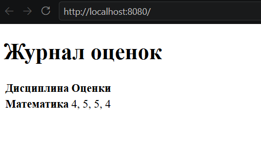

# Практическое задание 5. Простой веб-сервер (GET/POST)

## Задание

Написать простой веб-сервер для обработки GET и POST HTTP-запросов с помощью библиотеки socket в Python. Сервер должен:

- Принимать и записывать информацию о дисциплине и оценке по дисциплине.
- Отдавать информацию обо всех оценках по дисциплинам в виде HTML-страницы.

## Выполнение

```py
class MyHTTPServer:
    def __init__(self, host, port, server_name):
        self._host = host
        self._port = port
        self._server_name = server_name
        self._grades = {}
```

В работе был использован базовый класс сервера `MyHTTPServer`. Оценки хранятся в словаре в парах дисциплина - список оценок.

```py
def serve_forever(self):
    serv_sock = socket.socket(
        socket.AF_INET,
        socket.SOCK_STREAM,
        proto=0)

    try:
        serv_sock.bind((self._host, self._port))
        serv_sock.listen()

        while True:
            conn, _ = serv_sock.accept()
            with conn:
                try:
                    self.serve_client(conn)
                except Exception as e:
                    print('Client serving failed', e)

    finally:
        serv_sock.close()
```

Сервер запускается методом `serve_forever`, который создает сокет, принимает подключение и обрабатывает клиента.

```py
def serve_client(self, conn):
        rfile = conn.makefile('rb')
        try:
            try:
                req = self.parse_request(rfile)
            except ConnectionResetError:
                return
            except Exception as e:
                self.send_error(conn, HTTPStatus.BAD_REQUEST, str(e))
                return

            try:
                resp = self.handle_request(req)
            except NotImplementedError:
                self.send_error(conn, HTTPStatus.NOT_IMPLEMENTED, 'Request handler is not implemented')
            except Exception as e:
                self.send_error(conn, HTTPStatus.INTERNAL_SERVER_ERROR, str(e))
            else:
                self.send_response(conn, resp)
        finally:
            rfile.close()
```

Метод `serve_client` считывает данные и вызывает методы для обработки запроса, а затем закрывает соединение. Также он обрабатывает ошибки.

```py
def parse_request(self, rfile):
    raw = rfile.readline(MAX_LINE + 1)
    if len(raw) > MAX_LINE:
        raise Exception('Request line is too long')

    req_line = str(raw, 'iso-8859-1')
    req_line = req_line.rstrip('\r\n')
    words = req_line.split()
    if len(words) != 3:
        raise Exception('Malformed request line')

    method, target, ver = words
    if ver != 'HTTP/1.1':
        raise Exception('Unexpected HTTP version')

    headers = self.parse_headers(rfile)
    content_length = headers.get('Content-Length', '0')
    body_length = int(content_length)
    body = rfile.read(body_length)
    if len(body) != body_length:
        raise Exception('Incomplete request body')

    return Request(method, target, ver, headers, body, rfile)
```

Метод `parse_request` достает из данных метод, цель и версию HTTP, вызывает метод для обработки заголовков и возвращает обработанный запрос в виде экземпляра класса `Request`.

```py
class Request:
    def __init__(self, method, target, version, headers, body, rfile):
        self.method = method
        self.target = target
        self.version = version
        self.headers = headers
        self.body = body
        self.rfile = rfile

    @property
    def path(self):
        return self.url.path

    @property
    @lru_cache(maxsize=None)
    def query(self):
        return parse_qs(self.url.query)

    @property
    @lru_cache(maxsize=None)
    def url(self):
        return urlparse(self.target)
```

```py
def parse_headers(self, rfile):
    headers = []
    while True:
        line = rfile.readline(MAX_LINE + 1)
        if len(line) > MAX_LINE:
            raise Exception('Header line is too long')

        if line in (b'\r\n', b'\n', b''):
            break

        headers.append(line)
        if len(headers) > MAX_HEADERS:
            raise Exception('Too many headers')
    header_text = ''.join(line.decode('iso-8859-1') for line in headers)
    return Parser().parsestr(header_text)
```

Метод `parse_headers` построчно считывает заголовки и использует парсер из библиотеки `email`.

```py
def handle_request(self, request):
    if request.path not in ('/', '/grades'):
        return HTTPStatus.NOT_FOUND, {'Content-Type': 'text/plain; charset=utf-8'}, 'Not Found'

    if request.method == 'GET':
        return HTTPStatus.OK, {'Content-Type': 'text/html; charset=utf-8'}, self.render_grades()

    if request.method == 'POST':
        try:
            form = parse_qs(request.body.decode('utf-8'), keep_blank_values=True)
        except UnicodeDecodeError:
            return HTTPStatus.BAD_REQUEST, {'Content-Type': 'text/plain; charset=utf-8'}, 'Form data must be UTF-8'

        discipline = form.get('discipline', [''])[0].strip()
        grade = form.get('grade', [''])[0].strip()
        if not discipline or not grade:
            return HTTPStatus.BAD_REQUEST, {'Content-Type': 'text/plain; charset=utf-8'}, 'Discipline and grade are required'

        self._grades.setdefault(discipline, []).append(grade)
        return HTTPStatus.SEE_OTHER, {'Location': '/'}, ''
```

Метод `handle_request` обрабатывает запрос и в зависимости от метода и пути запроса возвращает ответ в виде статуса запроса, типа контента и тела.

```py
def render_grades(self):
    if self._grades:
        rows = ''.join(
            '<tr><th>{}</th><td>{}</td></tr>'.format(
                escape(discipline),
                ', '.join(escape(grade) for grade in grades),
            )
            for discipline, grades in self._grades.items()
        )
    else:
        rows = '<tr><td colspan="2">Оценок пока нет</td></tr>'

    return '''<!doctype html>
<html lang="ru">
<head><meta charset="utf-8"><title>Журнал оценок</title></head>
<body>
  <h1>Журнал оценок</h1>
  <table>
    <thead><tr><th>Дисциплина</th><th>Оценки</th></tr></thead>
    <tbody>{}</tbody>
  </table>
</body>
</html>'''.format(rows)
```

Метод `render_grades` возвращает HTML-страницу с оценками по всем дисциплинам.

```py
def send_response(self, conn, response):
    status, headers, body = response
    status = HTTPStatus(status)
    if isinstance(body, str):
        body = body.encode('utf-8')
    elif not isinstance(body, bytes):
        raise TypeError('Response body must be str or bytes')

    response_headers = dict(headers)
    response_headers.setdefault('Content-Length', str(len(body)))
    response_headers.setdefault('Connection', 'close')
    response_headers.setdefault('Server', self._server_name)

    lines = [f'HTTP/1.1 {status.value} {status.phrase}\r\n']
    lines.extend(f'{key}: {value}\r\n' for key, value in response_headers.items())
    lines.append('\r\n')
    conn.sendall(''.join(lines).encode('iso-8859-1') + body)
```

Метод `send_response` отправляет клиенту сформированный ответ на HTTP-запрос.


