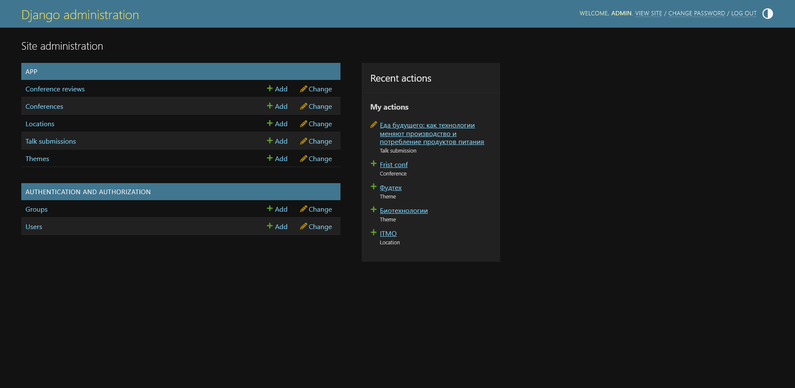

# Админ-панель

Через админку сайта по адресу `/admin` можно получить доступ ко всем таблицам базы данных. Здесь админ может обрабатывать заявки и менять их статус, создавать новые конференции, темы и локации.

```py
admin.site.register(Location)
admin.site.register(Theme)
admin.site.register(Conference)
admin.site.register(TalkSubmission)
admin.site.register(ConferenceReview)
```


