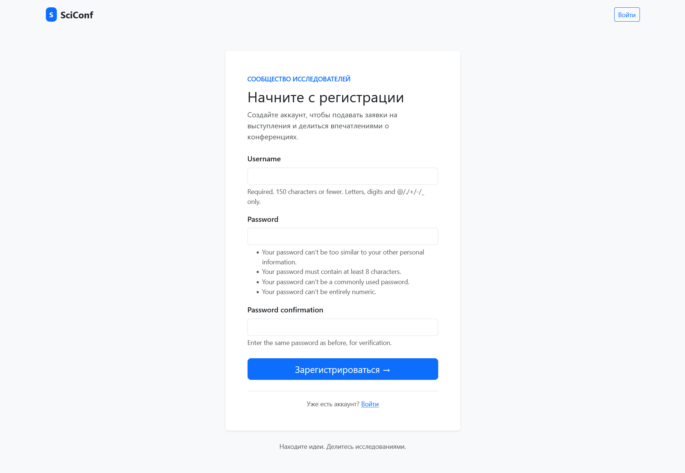
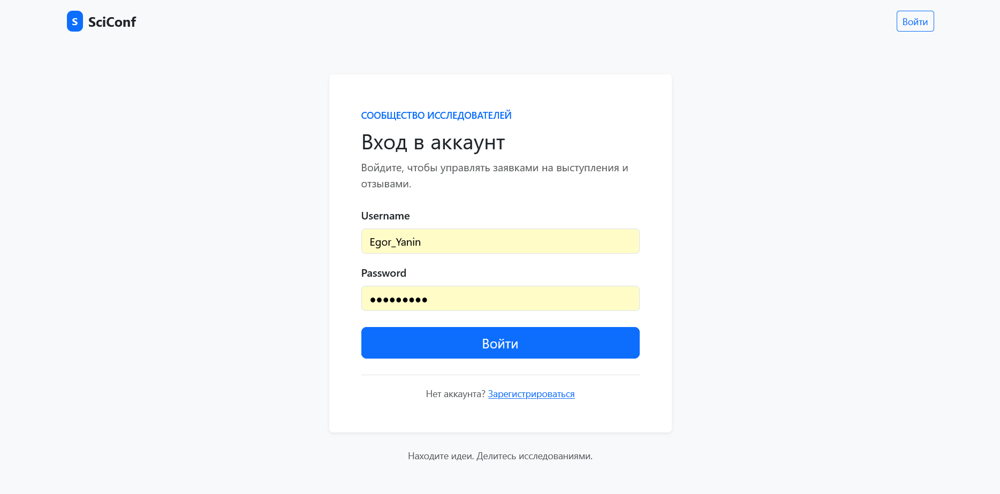

# Регистрация и авторизация

Для верстки сайта использовалось готовое CSS решение Bootstrap, пожтому для корректного обнаружения форм нужна функция `_style_form`. Для регистрации используется представление `register` и форма создания пользователя Django `UserCreationForm`. Для входа и выхода используются `LoginView` и `LogoutView`.

```py
def _style_form(form):
    for field in form:
        classes = field.field.widget.attrs.get("class", "")
        field.field.widget.attrs["class"] = f"{classes} form-control".strip()
        if field.errors:
            field.field.widget.attrs["class"] += " is-invalid"


class StyledLoginView(LoginView):
    template_name = "app/login.html"
    redirect_authenticated_user = True

    def get_form(self, form_class=None):
        form = super().get_form(form_class)
        _style_form(form)
        return form


class RegistrationLogoutView(LogoutView):
    next_page = reverse_lazy("login")


def register(request):
    if request.method == "POST":
        form = UserCreationForm(request.POST)
        _style_form(form)
        if form.is_valid():
            form.save()
            messages.success(request, "Регистрация прошла успешно. Теперь войдите в аккаунт.")
            return redirect("conference_list")
    else:
        form = UserCreationForm()
        _style_form(form)

    return render(request, "app/register.html", {"form": form})
```



