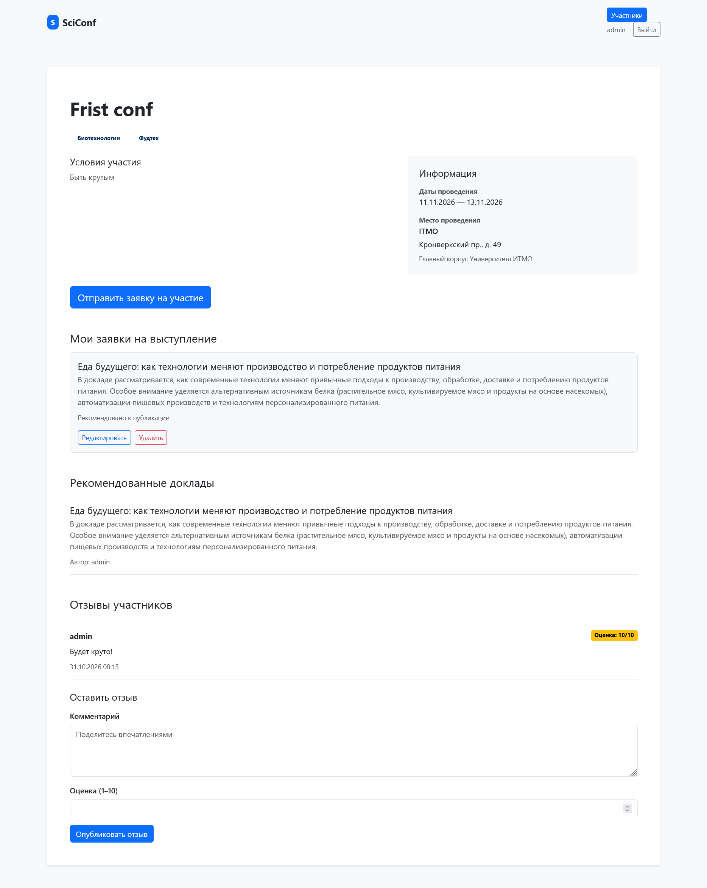
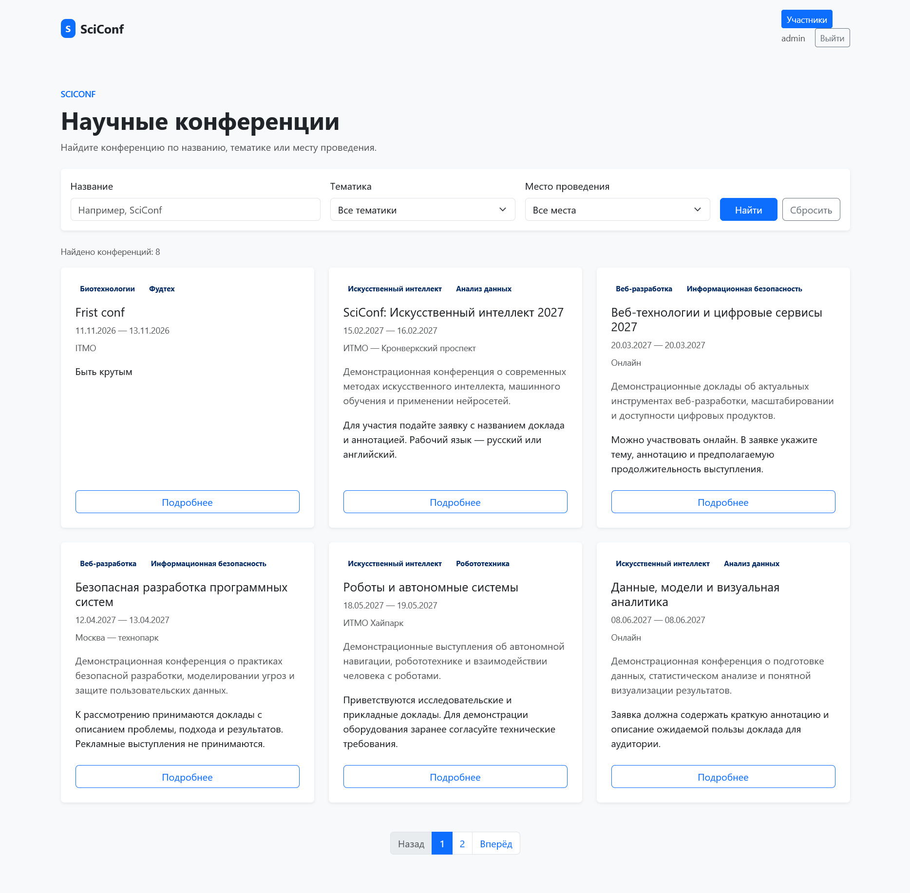

# Конференции

## Страница конференции

По URL `conferences/<int:conference_id>/` можно получить странцу с деталями конференции по её `ID`. На этой странице отображается название, описание, темы, условия участия, даты проведения, место проведения. Подать заявку пожно нажав по кнопке или по ссылке `conferences/<int:conference_id>/submit/`. Поданные заявки пользователя отображаются на этой же странице, их можно редактировать и удалять, а также посмотреть статус. Здесь же отображаются все рекомендованные к выступлению доклады. Еще ниже - отзывы на конференцию, которые подаются через форму `ConferenceReviewForm`.

```py
def conference_detail(request, conference_id):
    conference = get_object_or_404(
        Conference.objects.select_related("location").prefetch_related("themes"),
        pk=conference_id,
    )
    if request.method == "POST":
        if not request.user.is_authenticated:
            return redirect_to_login(
                request.get_full_path(),
                login_url=reverse_lazy("login"),
            )
        review_form = ConferenceReviewForm(request.POST)
        _style_form(review_form)
        if review_form.is_valid():
            review = review_form.save(commit=False)
            review.conference = conference
            review.reviewer = request.user
            review.save()
            messages.success(request, "Ваш отзыв опубликован.")
            return redirect("conference_detail", conference_id=conference.pk)
    else:
        review_form = ConferenceReviewForm()
        _style_form(review_form)

    reviews = ConferenceReview.objects.filter(conference=conference).select_related(
        "reviewer"
    ).order_by("-created_at")
    recommended_submissions = (
        TalkSubmission.objects.filter(
            conference=conference,
            recommended_to_publish=True,
        )
        .select_related("author")
        .order_by("submitted_at")
    )
    my_submissions = TalkSubmission.objects.none()
    if request.user.is_authenticated:
        my_submissions = TalkSubmission.objects.filter(
            conference=conference,
            author=request.user,
        ).order_by("-submitted_at")
    return render(
        request,
        "app/conference_detail.html",
        {
            "conference": conference,
            "review_form": review_form,
            "reviews": reviews,
            "recommended_submissions": recommended_submissions,
            "my_submissions": my_submissions,
        },
    )
```



## Список конференций

На главной странице доступен список всех конференций, фильтры по названию, теме и локации. Список собран в страницы по 6 штук. Пагинация происходит с помощью `Paginator` из Django.

```py
def conference_list(request):
    conferences = Conference.objects.select_related("location").prefetch_related("themes")
    search_query = request.GET.get("q", "").strip()
    theme_id = request.GET.get("theme", "").strip()
    location_id = request.GET.get("location", "").strip()

    if search_query:
        conferences = conferences.filter(name__icontains=search_query)
    if theme_id.isdigit():
        conferences = conferences.filter(themes__id=int(theme_id))
    if location_id.isdigit():
        conferences = conferences.filter(location_id=int(location_id))

    conferences = conferences.order_by("start_date", "pk").distinct()
    paginator = Paginator(conferences, 6)
    page_obj = paginator.get_page(request.GET.get("page"))
    query_params = request.GET.copy()
    query_params.pop("page", None)
```


