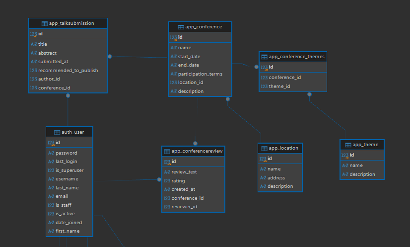

# Модель данных

`Conference` содержит название конференции, описание, начало и конец, условия участия, внешний ключ к таблице `Location` и отношение многие ко многим с таблицей `Theme`.

`Location` содержит название, адрес и описание. `Theme` содержит название и описание.

`TalkSubmission` явдяется заявкой на участие в конференции. Она содержит название доклада, содержание, время подачи, булеву переменную рекомендации к выступлению и внешние ключи `Conference` и `User`.

`ConferenceReview` содержит информацию об отзывах на конференцию. Она включает текст отзыва, время публикации, рейтинг от 1 до 10, внешние ключи `User` и `Conference`.

`Profile` расширяет таблицу `User`, добавляя с помощью поля один-к-одному имя, фамилию и биографию.
