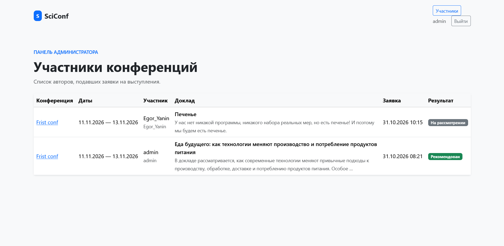

# Участники

Если пользователь - администратор, ему отображается кнопка "Участники" в шапке. По ней доступна таблица всех заявок на участие с конференциями, участниками, темами докладов и описаниями, а также статусами. Проверка на статус пользователя порисходит с помощью `user.is_staff`. Кнопка отображается с помощью "".

```py
@login_required(login_url="login")
def participant_list(request):
    if not request.user.is_staff:
        raise PermissionDenied
    participants = (
        TalkSubmission.objects.select_related("conference", "author")
        .order_by("conference__start_date", "conference__name", "author__username")
    )
    return render(
        request,
        "app/participant_list.html",
        {"participants": participants},
    )
```


